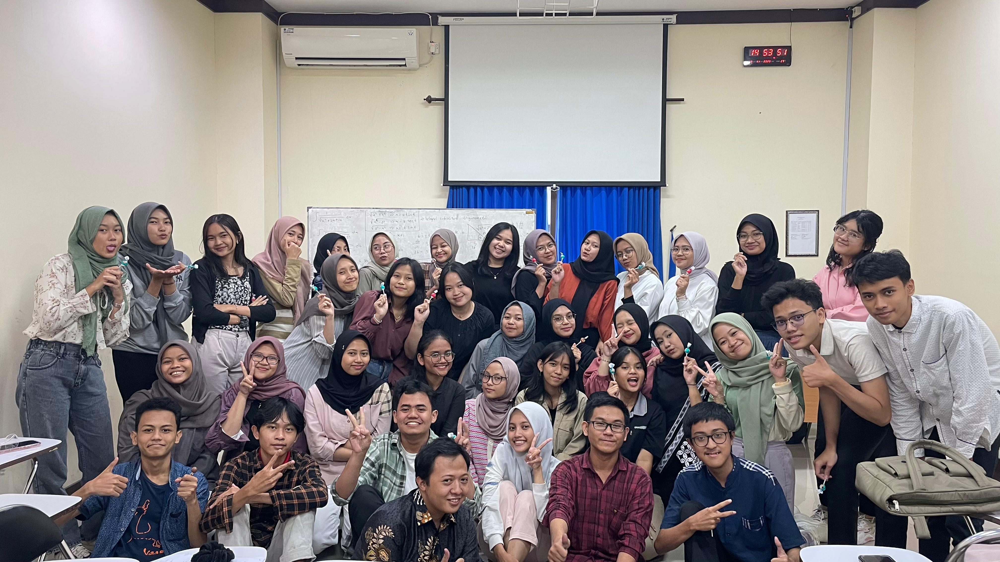

Sebagai asisten dosen dan tutor sebaya, saya mendampingi mahasiswa dalam sesi latihan dan diskusi di luar jam kuliah. Di halaman ini saya membagikan bahan ajar, soal, dan pembahasan yang kami gunakan.

## Asisten dosen Kalkulus I (2023)

Saya menjadi asisten dosen Kalkulus I bersama Yehezkiel Gibrael Dativa Garin dan Zahra Nazila Annisa, di bawah bimbingan Corina Karim, S.Si., M.Si., Ph.D., selaku dosen pengampu dan penanggung jawab mata kuliah. Kami mengadakan sesi latihan tambahan, membantu mahasiswa di luar jam kuliah, dan menggantikan dosen saat beliau berhalangan hadir.

{: .align-center width="500px"}

| Pekan | Materi | Latihan dan pembahasan |
| --- | --- | --- |
| 0 | [Pertidaksamaan](/files/TeachAssist/1.%20Pertidaksamaan.pdf) | — |
| 1 | [Limit fungsi](/files/TeachAssist/2.%20Limit%20Fungsi.pdf) | — |
| 2 | [Aplikasi limit](/files/TeachAssist/3.%20Aplikasi%20Limit.pdf) | [Tugas](/files/TeachAssist/Tugas%201.pdf), [Pembahasan tugas](/files/TeachAssist/Tugas%201_sol.pdf) |
| 3 | [Turunan](/files/TeachAssist/4.%20Turunan.pdf) | [Tugas](/files/TeachAssist/Tugas%202.pdf), [Pembahasan tugas](/files/TeachAssist/Tugas%202_sol.pdf) |
| 4 | [Aplikasi turunan](/files/TeachAssist/5.%20Aplikasi%20Turunan.pdf) | [Tugas](/files/TeachAssist/Tugas%203.pdf), [Pembahasan tugas](/files/TeachAssist/Tugas%203_sol.pdf) |
| 5 | [Integral tentu dan tak tentu](/files/TeachAssist/6.%20Integral%20Tentu%20dan%20Tak%20Tentu.pdf) | [Tugas](/files/TeachAssist/Tugas%204.pdf), [Pembahasan tugas](/files/TeachAssist/Tugas%204_sol.pdf) |
| 6 | [Fungsi transenden dan logaritma](/files/TeachAssist/7.%20Fungsi%20Transenden%20dan%20Logaritma.pdf) | [Tugas](/files/TeachAssist/Tugas%205.pdf), [Pembahasan tugas](/files/TeachAssist/Tugas%205_sol.pdf) |
| 7 | [Teknik pengintegralan](/files/TeachAssist/8.%20Teknik%20Pengintegralan.pdf) | [Tugas](/files/TeachAssist/Tugas%206.pdf), [Pembahasan tugas](/files/TeachAssist/Tugas%206_sol.pdf) |

## Asisten dosen Struktur Aljabar II (2024)

Saya menjadi asisten dosen Struktur Aljabar II bersama Nayaka Reswara Nararya Hidayat dan Nazra Arta Mevia Agustian. Dosen pengampu sekaligus penanggung jawab mata kuliah ini adalah Dr. Vira Hari Krisnawati, S.Si., M.Sc. Kami mendampingi mahasiswa mengerjakan soal tambahan dan berdiskusi tentang konsep-konsep aljabar di luar jam kuliah.

| Pekan | Materi | Latihan dan pembahasan |
| --- | --- | --- |
| 1 | [Gelanggang, lapangan, dan daerah integral](/files/TeachAssist_SAII/1.%20Ring%20Field%20Integral.pdf) | [Pembahasan materi](/files/TeachAssist_SAII/1.%20Ring%20Field%20Integral_sol.pdf) |
| 2 | [Karakteristik gelanggang, subgelanggang, dan ideal](/files/TeachAssist_SAII/2.%20Char%20Ring%20Subring%20Ideal.pdf) | [Pembahasan materi](/files/TeachAssist_SAII/2.%20Char%20Ring%20Subring%20Ideal_sol.pdf), [Tugas](/files/TeachAssist_SAII/Tugas%201.pdf), [Pembahasan tugas](/files/TeachAssist_SAII/Tugas%201_sol.pdf) |
| 3 | [Gelanggang polinomial](/files/TeachAssist_SAII/3.%20Ring%20Polinomial.pdf) | [Pembahasan materi](/files/TeachAssist_SAII/3.%20Ring%20Polinomial_sol.pdf) |
| 4 | [Latihan UTS](/files/TeachAssist_SAII/4.%20Latihan%20Soal%20UTS.pdf) | [Pembahasan materi](/files/TeachAssist_SAII/4.%20Latihan%20Soal%20UTS_sol.pdf), [Simulasi UTS](/files/TeachAssist_SAII/Mock%20UTR.pdf), [Pembahasan simulasi UTS](/files/TeachAssist_SAII/Mock%20UTR_sol.pdf) |
| 5 | [Gelanggang faktor dan lapangan hingga](/files/TeachAssist_SAII/5.%20Ring%20Faktor%20dan%20Field%20Berhingga.pdf) | [Pembahasan materi](/files/TeachAssist_SAII/5.%20Ring%20Faktor%20dan%20Field%20Berhingga_sol.pdf) |
| 6 | [Homomorfisme gelanggang](/files/TeachAssist_SAII/6.%20Hom%20Ring.pdf) | [Pembahasan materi](/files/TeachAssist_SAII/6.%20Hom%20Ring_sol.pdf) |
| 7 | [Isomorfisme gelanggang](/files/TeachAssist_SAII/7.%20Isomorf%20Ring.pdf) | [Pembahasan materi](/files/TeachAssist_SAII/7.%20Isomorf%20Ring_sol.pdf), [Tugas](/files/TeachAssist_SAII/Tugas%202.pdf), [Pembahasan tugas](/files/TeachAssist_SAII/Tugas%202_sol.pdf) |
| 8 | [Latihan tambahan](/files/TeachAssist_SAII/Latihan%20Soal%20Tambahan.pdf) | — |
| 9 | [Ideal prima dan ideal maksimal](/files/TeachAssist_SAII/8.%20Ideal%20Prima%20Maksimal.pdf) | [Pembahasan materi](/files/TeachAssist_SAII/8.%20Ideal%20Prima%20Maksimal_sol.pdf), [Simulasi UAS](/files/TeachAssist_SAII/Mock%20UAS.pdf), [Pembahasan simulasi UAS](/files/TeachAssist_SAII/Mock%20UAS_sol.pdf) |

## Mathematics IP 4.0 (sejak 2022)

HIMATIKA Universitas Brawijaya menyelenggarakan program ini untuk membantu mahasiswa Matematika dan Aktuaria menghadapi ujian tengah semester (UTS) dan ujian akhir semester (UAS). Dalam pertemuan kami, saya biasanya mengulas materi secara singkat, lalu mengajak peserta membahas soal ujian tahun-tahun sebelumnya.

| Periode | Mata kuliah yang saya ajar |
| --- | --- |
| UAS 2022 | Logika dan Himpunan |
| UTS 2023 | Kalkulus I dan Persamaan Diferensial Parsial |
| UAS 2023 | Kalkulus I, Matematika Dasar I (Kalkulus I untuk Aktuaria), dan Aljabar Linear Elementer |
| UTS 2024 | Kalkulus II, Matematika Dasar II (Kalkulus II untuk Aktuaria), dan Persamaan Diferensial Parsial |
| UAS 2024 | [Kalkulus III](/files/MIP/2024%20UAS%20Kalkulus%20III.pdf), Matematika Dasar II, Analisis Real II, dan [Persamaan Diferensial Parsial untuk Aktuaria](/files/MIP/2024%20UAS%20PPD.pdf) |
| UTS 2025 | [Analisis Real I](/files/MIP/2025%20UTS%20-%20Analisis%20Real%20I.pdf) |
| UAS 2025 | [Analisis Real II](/files/MIP/2025%20UAS%20-%20Analisis%20Real.pdf) |
