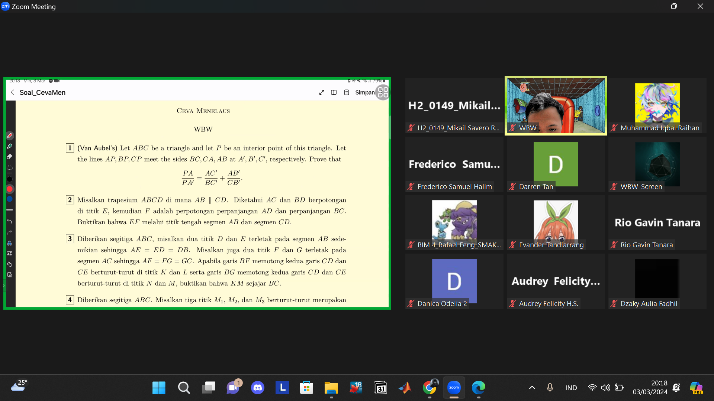

Sejak 2024, saya mengajar geometri tingkat lanjut secara daring dalam pelatihan nasional untuk Olimpiade Matematika Internasional (IMO).

{: .align-center width="500px"}

## 2024

Saya mengajar empat sesi. Dalam dua sesi pertama, kami mempelajari **sudut berarah** serta **Teorema Ceva dan Menelaus**, lalu menerapkannya pada soal latihan. Dua sesi berikutnya dikhususkan untuk membahas sepuluh soal geometri pilihan dan melatih penalaran peserta.

## 2025

Saya mengajar dua sesi geometri tingkat lanjut tentang **inversi** dan **koordinat kompleks**. Setelah mendalami teorinya, peserta menggunakan sisa waktu untuk mencoba soal-soal yang lebih sulit. Saya juga menjadi korektor pada beberapa tes seleksi untuk menentukan delegasi Indonesia ke IMO.

## 2026

Saya kembali diundang mengajar di **Pelatnas Tahap II**. Kali ini, saya membahas **inversi** dan **geometri projektif**. Setiap sesi dimulai dengan pembahasan teori, dilanjutkan dengan latihan soal tingkat lanjut.
