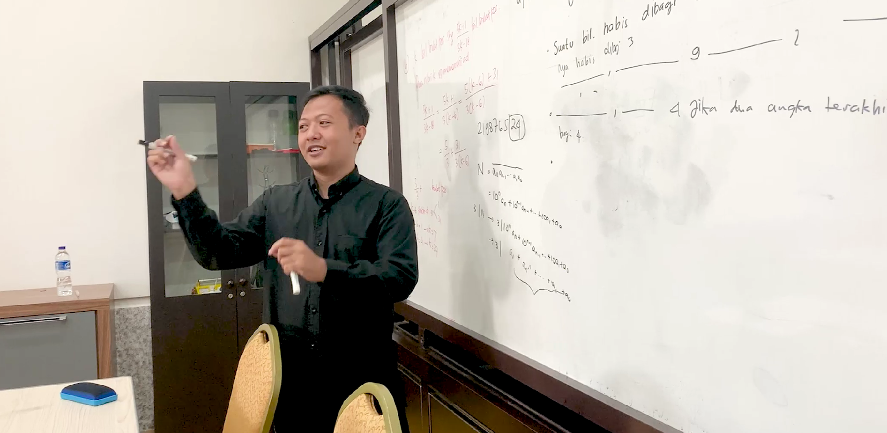
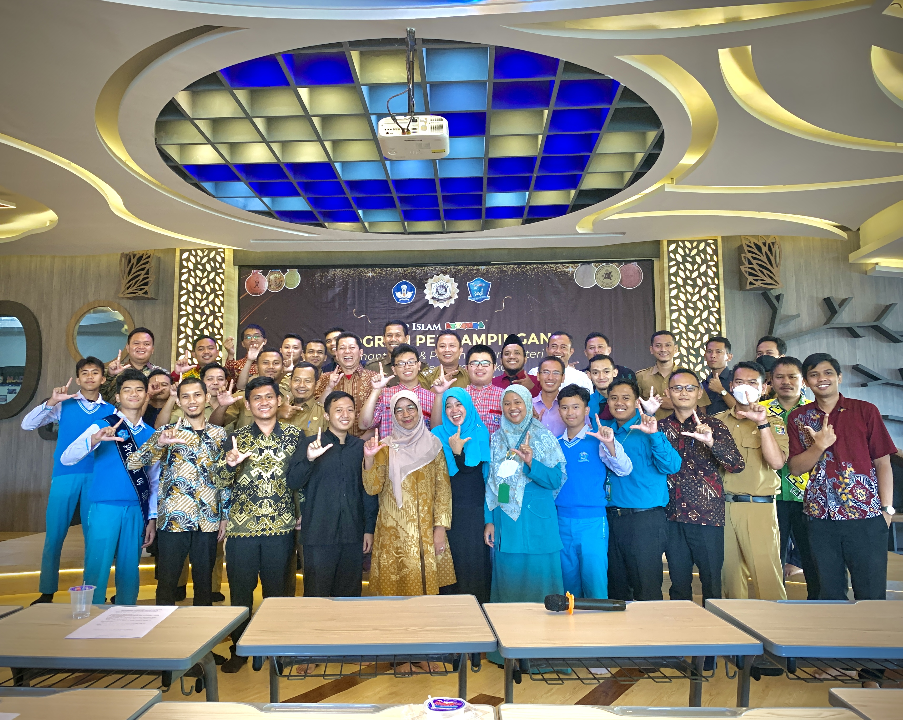

Selama dua hari, saya mengikuti program pengabdian kepada masyarakat **Dosen Berkarya** bersama Dr. Darmajid, S.Si., M.Si. dan Dra. Andari, MS. Kami mengenalkan olimpiade matematika kepada guru SMP dan SMA di Lampung.

## Materi pelatihan

Saya mengajar beberapa sesi dan mendampingi dosen saat jadwal saya memungkinkan. Bersama guru SMA, saya membahas kekongruenan dan kesebangunan segitiga serta aturan penjumlahan dan perkalian dalam kombinatorika. Bersama guru SMP, saya membahas pertidaksamaan dan keterbagian bilangan bulat.

Para guru sangat antusias saat kami mencoba menentukan apakah suatu bilangan habis dibagi 3, 4, 7, 9, 11, atau 13. Mereka menemukan cara baru untuk memeriksa keterbagian dengan memanfaatkan sifat masing-masing bilangan.

{: .align-center width="500px"}

## Bertemu kembali dengan sesama peserta olimpiade

Pada hari kedua, saya bertemu Denzel Elden Wijaya, yang saat itu berkuliah di NTU. Sewaktu SMA, saya mengenalnya sebagai salah satu pesaing tangguh dalam olimpiade matematika. Meski sebelumnya sudah saling tahu, baru di Lampung kami sempat berkenalan langsung.

{: .align-center width="500px"}
