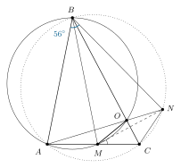
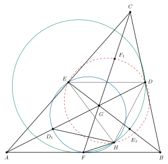
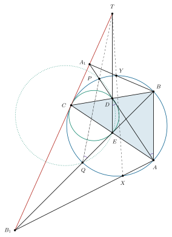

Contoh penggunaan dari **Wildan Bagus Wicaksono**. Berikut tiga diagram dari soal geometri yang saya gunakan. Di bawah setiap gambar, pilih **Buka di Studio** untuk menggeser titik dan melihat kodenya ikut berubah. Pilih **Unduh TikZ** untuk memakai gambar awal di modul.

## Paket LaTeX

Untuk memakai palet warna yang sama di seluruh modul, taruh dua baris ini di preamble, sebelum `\begin{document}`.

```latex
\usepackage[dvipsnames]{xcolor}
\usepackage{tikz}
```

Contoh pertama dan ketiga memakai `\usetikzlibrary{angles}` untuk menggambar busur sudut. Baris itu sudah ada di awal potongan TikZ masing-masing dan boleh dipindahkan ke preamble. Contoh kedua memakai warna `MidnightBlue`, `PineGreen`, dan `BrickRed`. Ketiga contoh memakai satu label per titik. Jika kamu ingin menambahkan kembali efek kontur putih dengan perintah `\contour` seperti pada kode asli saya, sertakan juga `\usepackage{contour}`.

## 1. Refleksi dan dua segiempat siklis

**Soal.** Diberikan segitiga $ABC$ dan titik $M$ terletak pada $\overline{AC}$. Titik $N$ merupakan bayangan pencerminan $M$ terhadap garis $BC$. Garis $AN$ memotong $\overline{BC}$ di $O$. Terlebih lagi, $A$, $B$, $M$, dan $O$ terletak pada lingkaran yang sama. Jika $\angle ABN=56^\circ$, berapakah besar $\angle CMN$?

<figure>
  
  <figcaption>Lingkaran bergaris penuh melalui $A$, $B$, $M$, dan $O$. Busur biru di $B$ menandai sudut yang diketahui. Busur di $M$ menandai sudut yang ditanyakan.</figcaption>
</figure>

<p><a class="btn btn--primary" href="./index.html#contoh/01-refleksi" target="_blank" rel="noopener">Buka di Studio</a> · <a href="./contoh-penggunaan/01-refleksi.stikz.json" download="01-refleksi.stikz.json">Unduh proyek</a> · <a href="./contoh-penggunaan/01-refleksi.tex" download="01-refleksi.tex">Unduh TikZ</a></p>

**Cara menggambar di Studio**

1. Pilih dua titik bebas $A$ dan $B$. Pilih **Busur dengan sudut**, masukkan $56^\circ$ dan pilih arah berlawanan jarum jam. Klik $B$ sebagai pusat, lalu $A$ sebagai titik awal. Dengan **Titik pada objek**, tempatkan $T$ di ujung lain busur dan $M$ di bagian dalamnya.
2. Buat titik tengah $H$ dari $MT$. Tarik garis $BH$ dan $AM$, lalu beri nama titik potongnya $C$. Buat **Segitiga** $ABC$. Karena $BM=BT$, garis $BC$ adalah sumbu tegak lurus $MT$.
3. Pakai **Refleksi terhadap garis** untuk mencerminkan $M$ terhadap $BC$. Namai bayangannya $N$ (posisinya berimpit dengan $T$). Potong $AN$ dengan sisi $BC$ untuk mendapatkan $O$. Buat lingkaran melalui $A,B,M$ dan lingkaran bertitik melalui $A,B,C$.
4. Hubungkan $B$ ke $M$ dan $N$, lalu $N$ ke $C$. Buat $MN$ putus-putus dan tebalkan $MO$. Dengan **Busur sudut**, klik $A,B,N$ lalu pilih **Besar sudut otomatis**. Untuk sudut yang ditanyakan, klik $C,M,N$ dan tampilkan busurnya saja. Sembunyikan objek bantu $T$, $H$, garis, dan busur awal.

Coba geser $M$ di sepanjang bagian dalam busur bantunya. Bayangan $N$, titik $C$, dan kedua lingkaran mengikuti konstruksi, sedangkan label sudut di $B$ tetap menunjukkan $56^\circ$.

<details><summary>Lihat kode TikZ</summary>
<pre><code class="language-latex">\usetikzlibrary{angles}
\begin{center}
\begin{tikzpicture}[scale=1, font=\small]
    \providecolor{MidnightBlue}{cmyk}{0.98,0.13,0,0.43}
    \coordinate (A) at (0, 0);
    \path (A) ++(-0.36, -0.29) node[inner sep=0pt] {$A$};
    \coordinate (B) at (1, 5);
    \path (B) ++(-0.055, 0.32) node[inner sep=0pt] {$B$};
    \coordinate (M) at (2, 0);
    \path (M) ++(0.025, -0.35) node[inner sep=0pt] {$M$};
    \coordinate (C) at (3.65855, 0);
    \path (C) ++(0.33, -0.25) node[inner sep=0pt] {$C$};
    \coordinate (N) at (4.58599, 1.375);
    \path (N) ++(0.32, 0.05) node[inner sep=0pt] {$N$};
    \coordinate (O) at (3.1555, 0.9461);
    \path (O) ++(-0.37, 0.18) node[inner sep=0pt] {$O$};

    \draw[thin] (1, 2.4) circle (2.6);
    \draw[semithick, opacity=0.8, dotted] (1.82927, 2.23415) circle (2.8875);
    \draw[semithick] (A)--(B);
    \draw[semithick] (B)--(C);
    \draw[semithick] (C)--(A);
    \draw[thin] (A)--(N);
    \draw[thin] (B)--(M);
    \draw[thin] (B)--(N);
    \draw[thin] (N)--(C);
    \draw[thin, dashed] (M)--(N);
    \draw[thick] (M)--(O);
    \pic[draw=MidnightBlue, thick, angle radius=0.39cm] {angle=A--B--N};
    \node[inner sep=0pt, text=MidnightBlue] at (0.49, 4.38) {$56^{\circ}$};
    \pic[draw=black, angle radius=0.39cm] {angle=C--M--N};

    % Radius cetak titik tetap 1.5pt saat scale diubah.
    \pgfgettransformentries{\studioXX}{\studioYX}{\studioXY}{\studioYY}{\studioDX}{\studioDY}
    \pgfmathsetlengthmacro{\studioRadiusTitik}{1.5pt/veclen(\studioXX,\studioYX)}
    \foreach \s in {A,B,M,C,N,O}
        \filldraw (\s) circle (\studioRadiusTitik);
\end{tikzpicture}
\end{center}
</code></pre>
</details>

## 2. Tiga lingkaran pada garis berat segitiga

**Soal.** Diberikan segitiga $ABC$ dengan $G$ titik potong ketiga garis beratnya. Titik $D$, $E$, dan $F$ berturut-turut merupakan titik tengah $BC$, $CA$, dan $AB$. Titik $D_1$, $E_1$, dan $F_1$ berturut-turut merupakan titik tengah $AG$, $BG$, dan $CG$. Buktikan bahwa lingkaran luar segitiga $D_1EF$, $DE_1F$, dan $DEF_1$ berpotongan di satu titik.

<figure>
  
  <figcaption>Lingkaran luar $D_1EF$ berwarna biru, lingkaran luar $DE_1F$ berwarna hijau, dan lingkaran luar $DEF_1$ digambar merah putus-putus. Huruf $H$ menandai perpotongan yang ingin diamati.</figcaption>
</figure>

<p><a class="btn btn--primary" href="./index.html#contoh/02-garis-berat" target="_blank" rel="noopener">Buka di Studio</a> · <a href="./contoh-penggunaan/02-garis-berat.stikz.json" download="02-garis-berat.stikz.json">Unduh proyek</a> · <a href="./contoh-penggunaan/02-garis-berat.tex" download="02-garis-berat.tex">Unduh TikZ</a></p>

**Cara menggambar di Studio**

1. Buat **Segitiga** $ABC$. Gunakan **Titik tengah** pada $BC$, $CA$, dan $AB$ untuk memperoleh $D$, $E$, dan $F$. Buat ruas $AD$, $BE$, dan $CF$. Dengan **Titik potong**, klik $AD$ dan $BE$ untuk membuat $G$.
2. Gunakan **Titik tengah** sekali lagi pada $AG$, $BG$, dan $CG$. Namai hasilnya $D_1$, $E_1$, dan $F_1$. Dengan **Lingkaran lewat 3 titik**, pilih berturut-turut $(D_1,E,F)$, $(D,E_1,F)$, dan $(D,E,F_1)$.
3. Pada gambar awal, klik dua lingkaran pertama dengan **Titik potong**, lalu pilih perpotongan selain $F$ untuk memperoleh $H$. Dalam proyek yang dapat diunduh, $H$ dikonstruksi sebagai bayangan $F$ terhadap garis penghubung kedua pusat lingkaran. Cara ini menjaga pilihan $H$ saat bentuk segitiga berubah. Kedua pusat dan sumbu cerminnya disembunyikan.
4. Tambahkan ruas $DE$, $EH$, $HD$, $D_1H$, dan $HF$ sesuai gambar. Pilih **Pilih / geser**, lalu seret huruf yang berdekatan dengan titik potong agar ada ruang antara label dan garis.

Coba geser $C$ untuk mengubah bentuk segitiga. Perhatikan perpotongan selain $F$ pada lingkaran biru dan hijau, lalu amati kedudukannya terhadap lingkaran merah.

<details><summary>Lihat kode TikZ</summary>
<pre><code class="language-latex">\begin{center}
\begin{tikzpicture}[scale=1, font=\small]
    \providecolor{MidnightBlue}{cmyk}{0.98,0.13,0,0.43}
    \providecolor{PineGreen}{cmyk}{0.92,0,0.59,0.25}
    \providecolor{BrickRed}{cmyk}{0,0.89,0.94,0.28}
    \coordinate (A) at (0, 0);
    \path (A) ++(-0.008, -0.3) node[inner sep=0pt] {$A$};
    \coordinate (B) at (9, 0);
    \path (B) ++(0.06, -0.303) node[inner sep=0pt] {$B$};
    \coordinate (C) at (7.24, 8.24);
    \path (C) ++(0.008, 0.33) node[inner sep=0pt] {$C$};
    \coordinate (D) at (8.12, 4.12);
    \path (D) ++(0.287, 0.04) node[inner sep=0pt] {$D$};
    \coordinate (E) at (3.62, 4.12);
    \path (E) ++(-0.223, 0.215) node[inner sep=0pt] {$E$};
    \coordinate (F) at (4.5, 0);
    \path (F) ++(-0.009, -0.3) node[inner sep=0pt] {$F$};
    \coordinate (G) at (5.41333, 2.74667);
    \path (G) ++(0.123, -0.495) node[inner sep=0pt] {$G$};
    \coordinate (D1) at (2.70667, 1.37333);
    \path (D1) ++(-0.184, -0.454) node[inner sep=0pt] {$D_{1}$};
    \coordinate (E1) at (7.20667, 1.37333);
    \path (E1) ++(0.266, -0.658) node[inner sep=0pt] {$E_{1}$};
    \coordinate (F1) at (6.32667, 5.49333);
    \path (F1) ++(0.415, 0.221) node[inner sep=0pt] {$F_{1}$};
    \coordinate (H) at (6.28748, 0.5786);
    \path (H) ++(0.116, -0.287) node[inner sep=0pt] {$H$};

    \draw[semithick, MidnightBlue] (4.77139, 2.21195) circle (2.22853);
    \draw[semithick, PineGreen] (4.22861, 3.8888) circle (3.89825);
    \draw[semithick, BrickRed, dashed] (5.87, 3.03945) circle (2.49601);
    \draw[thick] (A)--(B);
    \draw[thick] (B)--(C);
    \draw[thick] (C)--(A);
    \draw[thick] (A)--(D);
    \draw[thick] (B)--(E);
    \draw[thick] (C)--(F);
    \draw[thin] (D)--(E);
    \draw[thin] (E)--(H);
    \draw[thin] (H)--(D);
    \draw[thick] (D1)--(H);
    \draw[thick] (H)--(F);

    % Radius cetak titik tetap 1.5pt saat scale diubah.
    \pgfgettransformentries{\studioXX}{\studioYX}{\studioXY}{\studioYY}{\studioDX}{\studioDY}
    \pgfmathsetlengthmacro{\studioRadiusTitik}{1.5pt/veclen(\studioXX,\studioYX)}
    \foreach \s in {A,B,C,D,E,F,G,D1,E1,F1,H}
        \filldraw (\s) circle (\studioRadiusTitik);
\end{tikzpicture}
\end{center}
</code></pre>
</details>

## 3. Garis singgung dan dua garis berat

**Soal.** Diberikan segitiga $ABC$ yang tidak sama kaki dan garis $\ell$ yang menyinggung lingkaran luar segitiga $ABC$ di $C$. Titik $D$ dan $E$ berturut-turut merupakan titik tengah $BC$ dan $CA$. Garis $AD$ dan $BE$ memotong $\ell$ berturut-turut di $A_1$ dan $B_1$. Garis $AB_1$ memotong kembali lingkaran luar di $X$ selain $A$, dan $BA_1$ memotongnya kembali di $Y$ selain $B$. Buktikan bahwa $X$, $Y$, $D$, dan $E$ terletak pada satu lingkaran.

<figure>
  
  <figcaption>Pada garis singgung terdapat $B_1$, $C$, $A_1$, dan $T$. Lingkaran bertitik melalui $D,E,P,Q$. Lingkaran kecil bergaris penuh melalui $C,D,E$.</figcaption>
</figure>

<p><a class="btn btn--primary" href="./index.html#contoh/03-garis-singgung" target="_blank" rel="noopener">Buka di Studio</a> · <a href="./contoh-penggunaan/03-garis-singgung.stikz.json" download="03-garis-singgung.stikz.json">Unduh proyek</a> · <a href="./contoh-penggunaan/03-garis-singgung.tex" download="03-garis-singgung.tex">Unduh TikZ</a></p>

**Cara menggambar di Studio**

1. Buat **Segitiga** $ABC$ dan lingkaran luar melalui ketiga titik sudutnya. Buat titik tengah $D$ pada $BC$ serta $E$ pada $CA$. Tarik garis $AD$ dan $BE$.
2. Pilih **Garis singgung dari titik**, klik titik $C$, lalu klik lingkaran luar. Dengan **Titik potong**, buat $A_1=AD\cap\ell$, $B_1=BE\cap\ell$, dan $T=DE\cap\ell$. Untuk perpotongan di luar segitiga, gunakan garis penuh.
3. Tarik $AB_1$ dan $BA_1$. Potong kembali keduanya dengan lingkaran luar untuk mendapatkan $X$ dan $Y$. Lakukan hal serupa pada $AD$ dan $BE$ untuk mendapatkan $P$ selain $A$ dan $Q$ selain $B$.
4. Buat lingkaran bantu melalui $D,E,P$ dengan garis bertitik, dan lingkaran kecil melalui $C,D,E$. Gambar $XT$ dan $TQ$ putus-putus. Tarik $QP$ tipis, lalu gunakan satu busur untuk masing-masing sudut $\angle EQP$, $\angle EDA$, dan $\angle BAD$.

Coba aktifkan **Lihat objek tersembunyi**, pilih lingkaran **XYDE** di daftar objek, lalu klik **Tampilkan**. Lingkaran ini dibangun melalui $D,E,X$. Geser salah satu titik sudut segitiga dan periksa letak $Y$ terhadap lingkaran itu. Klik **Pas ke gambar** untuk melihat seluruh keliling.

<details><summary>Lihat kode TikZ</summary>
<pre><code class="language-latex">\usetikzlibrary{angles}
\begin{center}
\begin{tikzpicture}[scale=0.8, font=\small]
    \coordinate (A) at (0, 0);
    \path (A) ++(0.09, -0.512) node[inner sep=0pt] {$A$};
    \coordinate (B) at (0, 5);
    \path (B) ++(0.368, 0.368) node[inner sep=0pt] {$B$};
    \coordinate (C) at (-6, 4);
    \path (C) ++(-0.52, 0) node[inner sep=0pt] {$C$};
    \coordinate (D) at (-3, 4.5);
    \path (D) ++(-0.373, -0.444) node[inner sep=0pt] {$D$};
    \coordinate (E) at (-3, 2);
    \path (E) ++(0.168, -0.628) node[inner sep=0pt] {$E$};
    \coordinate (A1) at (-4.65672, 6.98507);
    \path (A1) ++(-0.502, 0.135) node[inner sep=0pt] {$A_{1}$};
    \coordinate (B1) at (-10.09091, -5.09091);
    \path (B1) ++(-0.52, 0) node[inner sep=0pt] {$B_{1}$};
    \coordinate (T) at (-3, 10.66667);
    \path (T) ++(0, 0.52) node[inner sep=0pt] {$T$};
    \coordinate (P) at (-3.94872, 5.92308);
    \path (P) ++(-0.715, 0.04) node[inner sep=0pt] {$P$};
    \coordinate (Q) at (-5.16667, -0.16667);
    \path (Q) ++(0.051, -0.578) node[inner sep=0pt] {$Q$};
    \coordinate (X) at (-2.24054, -1.13036);
    \path (X) ++(0, -0.52) node[inner sep=0pt] {$X$};
    \coordinate (Y) at (-2.70955, 6.15503);
    \path (Y) ++(0.368, 0.368) node[inner sep=0pt] {$Y$};

    \draw[thick] (-2.66667, 2.5) circle (3.65529);
    \draw[thick, dotted] (-6.41667, 3.25) circle (3.63815);
    \draw[thick] (-4.33333, 3.25) circle (1.82764);
    \draw[thick] (A)--(B);
    \draw[thick] (B)--(C);
    \draw[thick] (C)--(A);
    \draw[thick] (A)--(A1);
    \draw[thick] (B)--(B1);
    \draw[thick] (B1)--(T);
    \draw[thin, dashed] (X)--(T);
    \draw[thin, dashed] (T)--(Q);
    \draw[thick] (E)--(T);
    \draw[thick] (B1)--(A);
    \draw[thick] (B)--(A1);
    \draw[thin, opacity=0.45] (Q)--(P);
    \pic[draw=black, angle radius=0.39cm] {angle=E--Q--P};
    \pic[draw=black, angle radius=0.39cm] {angle=E--D--A};
    \pic[draw=black, angle radius=0.39cm] {angle=B--A--D};

    % Radius cetak titik tetap 1.5pt saat scale diubah.
    \pgfgettransformentries{\studioXX}{\studioYX}{\studioXY}{\studioYY}{\studioDX}{\studioDY}
    \pgfmathsetlengthmacro{\studioRadiusTitik}{1.5pt/veclen(\studioXX,\studioYX)}
    \foreach \s in {A,B,C,D,E,A1,B1,T,P,Q,X,Y}
        \filldraw (\s) circle (\studioRadiusTitik);
\end{tikzpicture}
\end{center}
</code></pre>
</details>

[Kembali ke panduan pengguna](./panduan.html)
