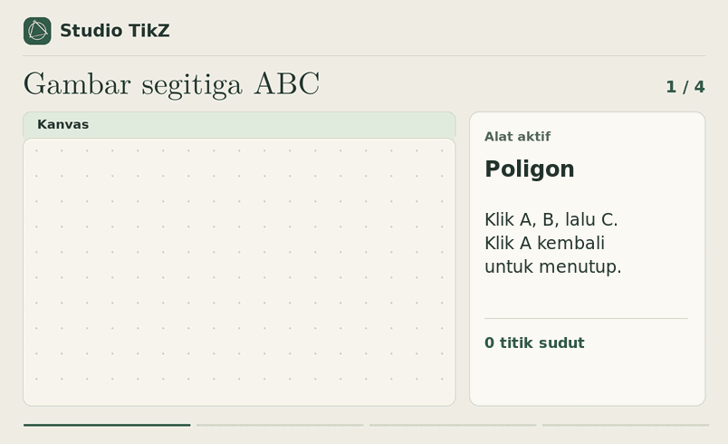



<p><a class="btn btn--primary" href="../index.html?lang=en">Open Studio TikZ</a> <a class="btn" href="#contoh-studio-tikz">Examples and LaTeX code</a> <a class="btn" href="../index.html" download="Studio-TikZ.html">Download the offline editor</a></p>

Studio TikZ was developed by **Wildan Bagus Wicaksono** with assistance from AI. [Homepage](https://wildan-wicaksono.github.io/)

When I prepare an olympiad handout, I usually move points around in GeoGebra until the diagram reads well, take the coordinates and type the TikZ by hand. GeoGebra provides its own TikZ export. I kept rewriting it because I have my own conventions for naming points, placing labels, colouring circles and marking angles.

I made **Studio TikZ** to see a construction alongside the code that goes into my handout. Draw a segment $AB$, select it and watch the corresponding line of code. Change the line to dashed and compare the two versions. I hope these small experiments make my TikZ style easier to learn.

With **Point**, click a blank spot to create a free point, or click segment $AB$ to place $P$ on it. Switch to **Select / move** and drag $P$ along $AB$. When you move $B$, the point follows the segment. [Try the Point animation](../index.html?lang=en#panduan/point).

To place a point at exactly $(2,0)$, I check **Show grid**, which also turns on **Snap to grid**. At 100% zoom, **Grid spacing** reads $1$ unit. I choose **Point**, move the pointer over blank space, and click when the marker reads $(2,0)$. With **Polygon**, I can place the first vertex there too, then click in the middle of a square for an off-grid second vertex. Snapping takes effect only near a grid intersection. To move a point, choose **Select / move** and drag the dot. Dragging the letter moves its label. [Grid and coordinates](guide.html#grid-and-coordinates).

Use **+** above the canvas to add a sheet, or choose several files with **Open file**. Each drawing has its own tab. In the **Sheet** menu, choose **Example sheets** to explore a construction or **Wildan’s worked examples** for olympiad diagrams. To return from an example, click the personal tab you want, or choose **My sheets → My drawing** for the last personal tab you used.

Choose the side-by-side layout to inspect the code while drawing, or stack the panels for a wider canvas. The browser remembers the layout and your Indonesian or English language preference. Focus the canvas before pressing **+** or **−** to zoom. The canvas zoom percentage and the printed TikZ scale can be adjusted independently.



## Construction and presentation

Choose **Polygon** and click the vertices in order. For triangle $ABC$, click $A$, $B$ and $C$, then click $A$ again or press **Enter** to close it. For a quadrilateral, add $D$ before closing. Click inside the finished shape to select or fill it. [Try the Polygon animation](../index.html?lang=en#panduan/polygon).

In the **Lines** menu, select **Perpendicular bisector**, then click the segment or its two endpoints. Drag $A$ and check that the line still passes through the midpoint. To bisect $\angle ABC$, choose **Internal angle bisector** or **External angle bisector** in **Lines**, then click $A$, $B$ and $C$, or click an existing angle mark.

For translation, rotation, reflection, dilation or inversion of an entire shape, select the tool and click inside the shape. The source-object list helps when objects overlap. For reflection, click the mirror point or line next. For inversion, click the reference circle. A pentagon maps edge by edge. You can then select its image for another transformation.

In **Sheet → Example sheets**, open [**Transforming a shape**](../index.html?lang=en#contoh/transformasi-bangun) and drag $A$ on the green pentagon. Its reflection is the blue point $A^{\prime}$ and its inverse is the orange point $A^{*}$. The other vertices follow the same pattern through $E^{\prime}$ and $E^{*}$. The [interactive inversion lesson](../index.html?lang=en#panduan/invert) follows one triangle closely. Its vertices $A$ and $B$ initially lie on the reference circle. Segment $AB$ maps to the semicircle from $A$ to $B$ through $M^{*}$, the image of its midpoint $M$. Drag the inversion centre $O$ and follow $M^{*}$ along the image arc. You can also enter a name such as `A*` in the **Name** field to label a point $A^{*}$.

Use **Label** on the top toolbar to add a free annotation. In a crowded diagram, select a point label, angle label or free label and switch on its translucent background. Lower the background opacity if a nearby line needs to remain prominent. Choose **Angle** beside **Label** on the top toolbar and click $A$, $B$ and $C$ to mark the angle at $B$. At $90^\circ$ the arc becomes a square mark. Move a point so the angle changes and the arc returns. The square has its own size control. Select several objects using **Ctrl+click** (or **⌘+click**) to change their colour or hide them together. Name and save the group to select the same objects again later. The same palette is available for outlines and fills.

Choose **Clip drawing** by the zoom controls to keep part of a diagram for a handout. Click opposite corners for a rectangle, or select a circle, sector or polygon as the boundary. The crop applies to the canvas and to the complete TikZ drawing, including its labels. [Try the clipping guide](../index.html?lang=en#panduan/editor-clip).

## Try a construction

In triangle $ABC$, place $D$ on $AB$ so that $AD=2\cdot DB$. Use the vector formula tool and enter `D = (A + 2B)/3`. Drag $B$ and observe how both the diagram and the coordinates change. The relevant line in the TikZ export is

```latex
\coordinate[label={[text=PineGreen]below:$D$}] (D) at (${1/3}*(A) + {2/3}*(B)$);
```

<details><summary>Play the construction animation</summary></details>

<iframe src="../contoh-vektor.html?lang=en" title="Interactive division of segment AB" loading="lazy" width="800" height="365" style="display:block;width:100%;height:365px;border:0"></iframe>

Drag $A$, $B$ or $C$ above. The point $D$ stays two-thirds of the way from $A$ to $B$. Open the [antiparallel-line animation](../index.html?lang=en#panduan/antiTriangle) for another example, then drag $D$ or segment $DE$ in the interactive construction.

<iframe src="../latihan-antiparalel.html?lang=en" title="Interactive antiparallel line in a triangle" loading="lazy" width="800" height="465" style="display:block;width:100%;height:465px;border:0"></iframe>

## Taking the diagram to LaTeX or AoPS

Copy the preamble from the code panel before pasting the figure into your document. Load `xcolor` with its `dvipsnames` option before TikZ. Studio adds the TikZ libraries used by the current figure, such as `angles` and `calc`. The examples above include the code for inspection.

For an AoPS diagram, open **Paste Asymptote**, paste the `[asy]` block and choose **Convert to TikZ**. For a diagram Studio can read directly, choose **Open in new sheet**. Use **Select / move** to drag the endpoint of a segment. The code panel updates as the endpoint moves, so you can copy the TikZ as soon as the segment looks right. Your other sheets stay open. [Open the Asymptote converter](../index.html?lang=en#asymptote).

The original Asymptote stays in the converter. To change the number of squares in **Nested squares**, for example, change `n = 25` to `n = 5` and convert again. In the Studio sheet you can drag points in the drawing the loop produced.

The converter supports constructions such as line–circle intersections, helper functions, opacity and clipping.

Try one of these problems from **AoPS Contests**. Open the thread and click the diagram in the **first post**. In the **Asymptote code below** window, select the text from `[asy]` through `[/asy]`, copy it, and paste it into **Paste Asymptote**.

- [2023 AIME II, Problem 6](https://artofproblemsolving.com/community/c5h3016174p27101321#post27101321) — an L-shaped region made of three unit squares.
- [2017 Canadian Open Mathematics Challenge, Problem A2](https://artofproblemsolving.com/community/c4h1722001p11140110#post11140110) — three circles centred at the vertices of an equilateral triangle, with shaded sectors.
- [2020 Chilean National Mathematics Olympiad, Level 2 Problem 2](https://artofproblemsolving.com/community/c6h2945846p26371900#post26371900) — a $4\times4$ lattice of points for counting squares.

For a diagram using a custom module or a 3D projection, open **Convert an SVG rendered by Asymptote** to bring the locally rendered paths into TikZ. In the other direction, the AoPS export wraps TikZ in a single Asymptote label. Pasting that wrapper into the converter recovers its original TikZ. [Read the conversion steps](guide.html#convert-aops-diagrams).

## Strengths and limits

### Strengths

- **Learn the TikZ while drawing.** When I select a segment, Studio highlights the command that draws it. I can copy the complete figure in the style I use for handouts, or take just the coordinates and write my own lines and labels.
- **Explore different positions in one construction.** Drag a triangle vertex and watch its incircle, angle bisector or inverse image move. The tool animations show where to click, and the interactive examples let readers move the points themselves.
- **Prepare the diagram for print.** I can reposition LaTeX labels, use translucent fills and choose angle marks. Changing the TikZ scale keeps the printed point radius at $1.5\,\mathrm{pt}$.
- **Reuse an AoPS diagram.** When Studio can open an Asymptote diagram on the canvas, I can reposition its points and copy TikZ that follows the drawing automatically. If I only need to change one command, I can also edit **TikZ code** directly in the converter.
- **Keep several drawings open, including offline.** I can name a tab for each problem and switch between them during class. The downloaded HTML includes the drawing tools, interactive examples and guide animations.

### Limitations

- **Autosave keeps sheets in the current browser.** **Save sheet** downloads the displayed drawing as one `.stikz.json` file. **Delete sheet** asks for confirmation before removing the selected sheet from browser storage. Use **Open file** to reopen a downloaded copy in a new tab alongside your other drawings.
- **The drawing tools focus on olympiad geometry.** Studio has no general tool for plotting functions or drawing conics from their equations. To plot a parabola such as $y=x^2$, I still use GeoGebra.
- **GeoGebra import covers some 2D objects.** Studio may read a point’s stored coordinates from a `.ggb` file even when its construction dependencies do not carry over. Saving a Studio drawing as `.stikz.json` preserves its construction.
- **Asymptote coordinates can lose construction relationships.** Some GeoGebra exports record only the center and radius of a circle. Before opening the sheet, use **Circles through three points** to choose the three points the circle should follow. Other points initially on the circumference can move off it as the drawing changes. [See the point selection example](guide.html#convert-aops-diagrams).
- **Pasting Asymptote can give an error.** If the block was cut short, copy it again from `[asy]` through `[/asy]`. Even a complete block that runs on AoPS can use a command or module Studio does not recognise. If the message gives a line and column, use **Go to this line** to inspect it. For unsupported features, render with Asymptote on your computer, then import the SVG or include the PDF in LaTeX. [SVG and PDF conversion steps](guide.html#convert-aops-diagrams).
- **Update the offline copy manually.** Download the latest HTML from this project page, then open your saved `.stikz.json` file in the new editor.

[Read the user guide](guide.html) · [Follow the three worked diagrams](examples.html)
